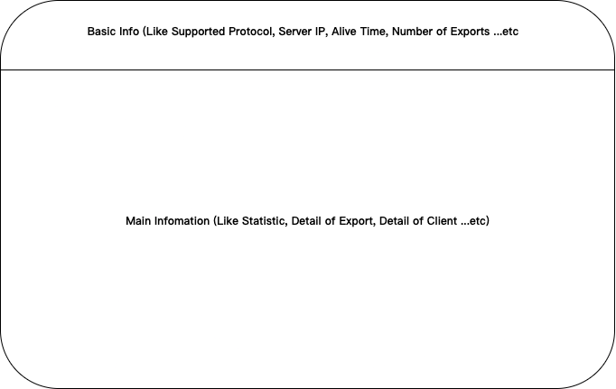

# HackWeek21 - Table Context
___There are two things I want to do in HackWeek.___

 1. Make nfs-ganesha more firendly to use.
	- [Monitor NFS status like top](https://github.com/Vicente-Cheng/nfs-ganesha/blob/HackWeek21/src/HackWeek/HackWeek21.md#monitor-nfs-status-like-top)
	- [Improve the CLI interface](https://github.com/Vicente-Cheng/nfs-ganesha/blob/HackWeek21/src/HackWeek/HackWeek21.md#improve-the-cli-interface-more-friendly)
 2. Improve cache layer mechanism
	- [Add document for it](https://github.com/Vicente-Cheng/nfs-ganesha/blob/HackWeek21/src/HackWeek/HackWeek21.md#mdcache-document)
	- [Improve the recycling mechanism](https://github.com/Vicente-Cheng/nfs-ganesha/blob/HackWeek21/src/HackWeek/HackWeek21.md#improve-the-recycling-mechanism)

# Monitor NFS Status like top

Like `top` related command (`atop`/`htop` ...etc).
To show the statistics like op respond time, op count, throughput, and something user needed.

  - Implement with Python [Curses](https://docs.python.org/3/howto/curses.html#)

# Improve the CLI interface more friendly

We need to make a friendly CLI that makes users change some config easily.
Now, Ganesha has various CLI for different purposes, maybe we could combine them.

# MDCache Document

MDCache is an important component of NFS-Ganesha but there is no document for it.

# Improve the recycling mechanism

In some specific scenarios, MDCache would not reuse entry reasonably. Maybe we could try to deal with it.
